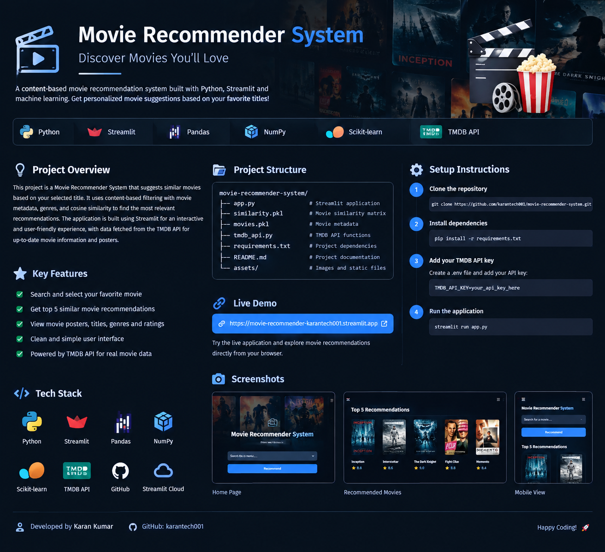

# 🎬 Movie Recommender System Using Machine Learning

<p align="center">
  
</p>

<p align="center">
  <b>Discover your next favorite movie with Machine Learning.</b>
</p>

<p align="center">
  A content-based movie recommendation web application built using Python and Streamlit.
</p>

---

## 📌 Project Overview

The **Movie Recommender System** is a Machine Learning project designed to help users discover movies similar to their selected movie.

The application analyzes movie-related information, including genres, keywords, cast, crew, and other available features, to identify similar movies and generate recommendations.

The project uses Python for data processing and recommendation logic, Streamlit for the interactive web interface, and The Movie Database (TMDB) API to retrieve movie posters.

## ✨ Features

- 🎥 **Movie Recommendations:** Get recommendations based on a selected movie.
- 🧠 **Machine Learning:** Uses a content-based similarity approach.
- 🖼️ **Movie Posters:** Fetches movie posters through the TMDB API.
- 🔎 **Interactive Interface:** Select a movie and view recommended titles.
- ⚡ **Fast Recommendations:** Uses precomputed similarity data.
- 🌐 **Web Application:** Built with Streamlit.
- ☁️ **Cloud Deployment:** Hosted using Streamlit Community Cloud.

## 🧠 Machine Learning Approach

This project follows a **content-based movie recommendation approach**.

The recommendation workflow includes:

1. **Data Collection:** Load the TMDB 5000 Movies and Credits datasets.
2. **Data Integration:** Merge movie and credits information.
3. **Data Preprocessing:** Extract and prepare relevant movie attributes.
4. **Feature Engineering:** Combine selected movie features to represent movie content.
5. **Similarity Calculation:** Compare movie representations to identify similar titles.
6. **Recommendation Generation:** Retrieve movies with the highest similarity to the selected movie.
7. **Poster Integration:** Use the TMDB API to display movie posters in the application.

The recommendation method is based on movie content rather than users' personal ratings or viewing histories.

## 📊 Dataset

The project uses two datasets:

- **TMDB 5000 Movies Dataset**
- **TMDB 5000 Credits Dataset**

The datasets contain movie information such as titles, genres, keywords, cast, crew, popularity, and plot descriptions.

The merged dataset contains approximately 4,809 rows and 23 columns before further processing.

## 🛠️ Technologies Used

| Technology | Purpose |
|---|---|
| Python | Core programming language |
| Pandas | Data manipulation and preprocessing |
| NumPy | Numerical operations |
| Scikit-learn | Machine Learning and similarity-related processing |
| Streamlit | Interactive web application |
| Requests | API communication |
| TMDB API | Movie poster and movie information retrieval |
| Pickle | Saving and loading processed data |
| Git & GitHub | Version control and project hosting |
| Streamlit Community Cloud | Application deployment |

## 🖥️ Application Workflow

1. Open the web application.
2. Select a movie from the available movie list.
3. Click the recommendation button.
4. View the recommended movies and their posters.

## 🚀 Run the Project Locally

### 1. Clone the Repository

```bash
git clone https://github.com/karantech001/movie-recommender-system.git
```

### 2. Open the Project Folder

```bash
cd movie-recommender-system
```

### 3. Install Dependencies

```bash
pip install -r requirements.txt
```

### 4. Configure the TMDB API Key

Create a folder named `.streamlit` in the project directory. Inside it, create a file named `secrets.toml`.

Add your own TMDB API key:

```toml
TMDB_API_KEY = "YOUR_TMDB_API_KEY"
```

**Important:** Never upload your real API key or `secrets.toml` file to a public GitHub repository.

### 5. Run the Application

```bash
streamlit run app.py
```

The application will open in your browser.

## ☁️ Deployment

The application can be deployed using Streamlit Community Cloud.

1. Connect your GitHub account.
2. Select this repository: `karantech001/movie-recommender-system`.
3. Select the `main` branch.
4. Set the main file path to `app.py`.
5. Add `TMDB_API_KEY` in the app's Secrets settings.
6. Deploy the application.

**Live Demo:** [Open the Movie Recommender System](https://movie-recommender-system-karankr.streamlit.app/)

Replace `YOUR_STREAMLIT_APP_URL` with your actual deployed Streamlit application URL.

## 📁 Project Structure

```text
movie-recommender-system/
│
├── app.py
├── movie_dict.pkl
├── requirements.txt
├── similarity.part000
├── similarity.part001
├── similarity.part002
├── similarity.part003
├── similarity.part004
├── similarity.part005
├── similarity.part006
├── similarity.part007
├── similarity.part008
├── split_similarity.py
├── .gitattributes
├── .gitignore
└── README.md
```

The `.streamlit/secrets.toml` file contains the private API key and should not be committed to GitHub.

## 🎯 Project Objectives

- Apply Machine Learning concepts to a real-world recommendation problem.
- Practice data preprocessing and feature engineering.
- Build an interactive application using Python.
- Integrate an external API into a web application.
- Deploy a Machine Learning project to the cloud.

## 🔮 Future Improvements

- Add movie filtering by genre and release year.
- Display movie ratings and additional details.
- Improve recommendation quality through feature engineering.
- Add user preferences and personalized recommendations.
- Optimize application performance and data loading.

## 👨‍💻 Developer

**Karan Kumar**

BCA Graduate | AI & Data Science

**Areas of Interest:** Machine Learning, Data Science, Artificial Intelligence, and Python Development.

**GitHub Repository:**  
https://github.com/karantech001/movie-recommender-system

---

## 📄 Acknowledgements

- [TMDB](https://www.themoviedb.org/) for movie-related data and poster information.
- [Streamlit](https://streamlit.io/) for the web application framework.
- [Scikit-learn](https://scikit-learn.org/) for Machine Learning tools.

---

<p align="center">
  <b>Built with Python, Machine Learning, and Streamlit ❤️</b>
</p>
